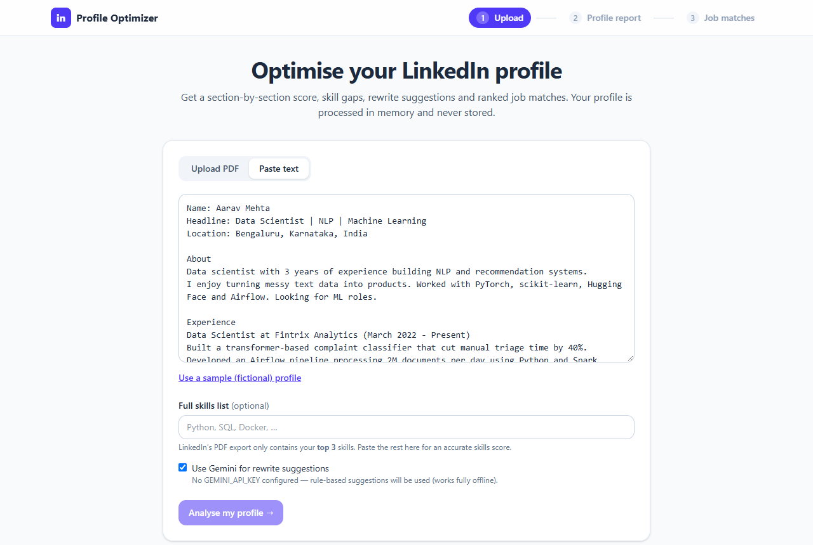
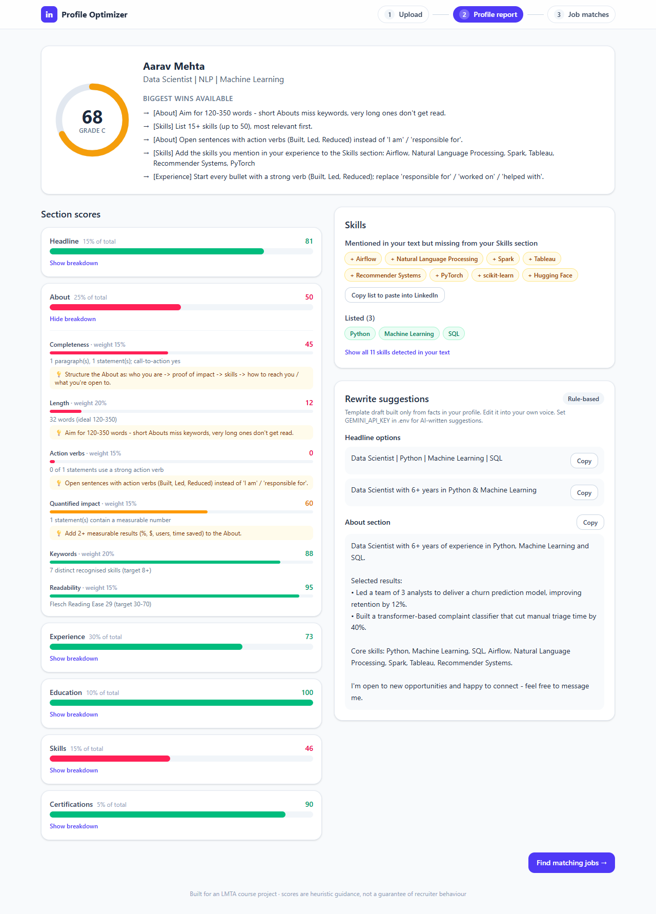
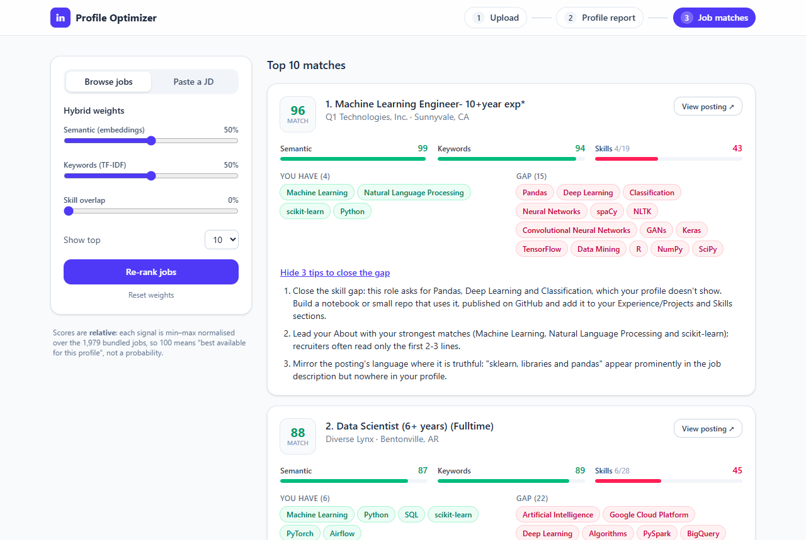
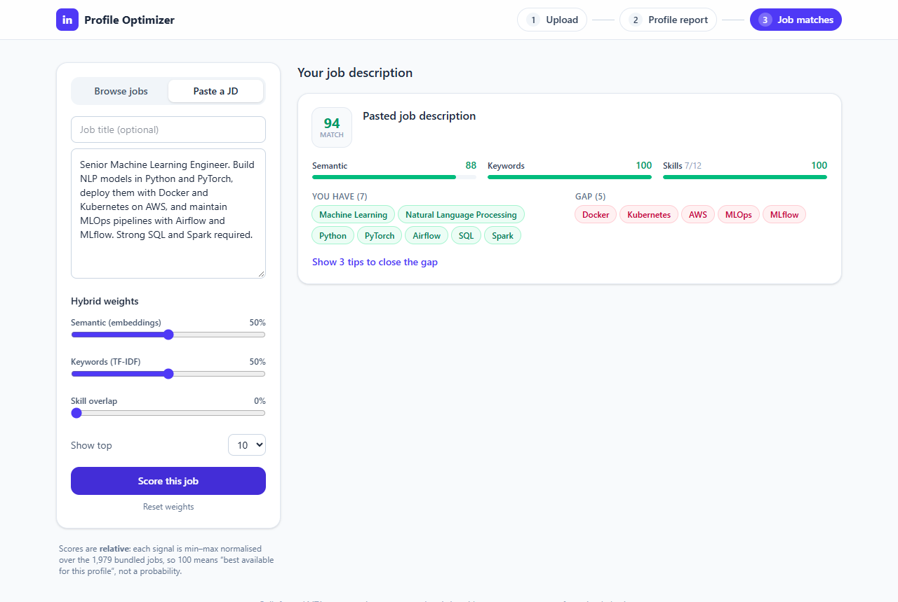
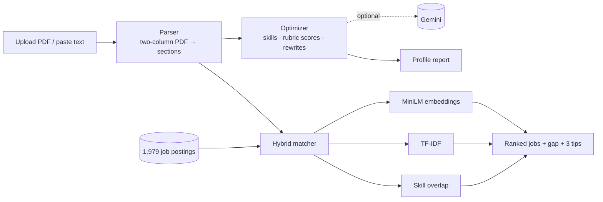

# LinkedIn Profile Optimizer & Job Matcher

An NLP application that **scores your LinkedIn profile section by section**, finds the skills you use but forgot to list, suggests rewrites for your headline and About, and **ranks real job postings** against your profile with a hybrid of sentence embeddings, TF-IDF and skill overlap — then tells you exactly which skills to close the gap on.

Built for the *Language Modeling & Text Analytics (LMTA)* course. It runs **fully offline** (an LLM is optional), takes your own LinkedIn PDF export (no scraping, so no ToS problem), and its matching quality is **measured**, not claimed — see [Results](#results).

## Screenshots

| 1 · Upload / paste | 2 · Profile report |
|---|---|
|  |  |

| 3 · Ranked job matches with skill gap & tips | 4 · Score one pasted job description |
|---|---|
|  |  |

*All screenshots use a fictional sample profile. Regenerate with `python scripts/take_screenshots.py`.*

## Features

**Profile input** — upload LinkedIn's *Save to PDF* export (its two-column layout is handled explicitly) or paste text. Parsed into headline, about, experience, education, skills, certifications.

**Profile optimizer**
- Per-section score 0–100 + overall score and grade, from a transparent rubric: *completeness, length, action verbs, quantified achievements, keyword density, readability* ([rubric table](docs/ARCHITECTURE.md#scoring-rubric)). Every metric shows its evidence and, when weak, a tip.
- Skill extraction with **spaCy `PhraseMatcher` + a bundled taxonomy** (~590 skills, ~190 aliases). Flags skills **used in your experience but missing from your Skills section**.
- Headline / About rewrites via **Gemini** (free tier, set in `.env`) with a **rule-based fallback** that only reuses facts from your own profile.

**Job matcher**
- 1,979 real LinkedIn job postings bundled (sampled from a public dataset — [provenance](data/README.md)), or paste any job description.
- **Hybrid score** = weighted *MiniLM embedding cosine* + *TF-IDF cosine* + *skill coverage*; weights configurable (`.env`, API, or UI sliders).
- Each match shows score, matched skills, missing skills and **3 concrete tips** to close the gap.

**Evaluation** — Precision@5, Recall@10, MRR, NDCG@10 for TF-IDF vs embeddings vs hybrid (plus skills-only and a random baseline) with bootstrap confidence intervals. One command regenerates [`docs/RESULTS.md`](docs/RESULTS.md).

## Results

30 **synthetic** profiles (10 role families × 3), each ranked against a labelled 100-job candidate pool from the real postings. Relevance is a title-based rule, not human judgement — see the limitations in [`RESULTS.md`](docs/RESULTS.md) before quoting these numbers.

| System | P@5 | R@10 | MRR | NDCG@10 |
|---|---|---|---|---|
| Random baseline | 0.080 | 0.100 | 0.225 | 0.084 |
| TF-IDF only | 0.607 | 0.533 | 0.886 | 0.636 |
| Embeddings only | 0.580 | 0.512 | 0.808 | 0.557 |
| Skills only | 0.320 | 0.321 | 0.555 | 0.344 |
| Preset blend (0.5 / 0.2 / 0.3) — my original guess | **0.627** | 0.562 | 0.900 | 0.644 |
| **Hybrid, default** (0.5 / 0.5 / 0) — *weights picked using this benchmark* | 0.620 | **0.592** | **0.950** | **0.677** |

What the numbers do and do not say:
- Every system beats the random baseline by a wide margin (default hybrid NDCG@10 0.677 vs 0.084 for random).
- **The default weights were chosen after a weight sweep on this same benchmark**, so the hybrid row is optimistic. Fairer figures: a 2-fold cross-validated choice gave held-out NDCG@10 0.677 (both folds picked 0.5 / 0.5 / 0), and the weights I fixed *before* seeing any result (0.5 / 0.2 / 0.3) scored 0.644.
- The default hybrid is clearly better than embeddings-only (ΔNDCG@10 = +0.119, 95% CI [+0.075, +0.166]) and skills-only. Against TF-IDF-only the gain is small (+0.040, CI [+0.003, +0.079]) and, given the tuning above, should not be read as a robust win.
- On the 10 *obfuscated* profiles (no role title in the headline) embeddings catch up with TF-IDF (0.553 vs 0.542) and the hybrid leads (0.630) — but n=10 is too small to call it a significant effect.
- Skill overlap does not improve ranking on this benchmark, which is why its default weight is 0. It still drives the matched / missing-skill view and tips, and you can rank with it by raising `WEIGHT_SKILLS` or using the UI sliders.

## Architecture



Details, formulas and design trade-offs: [`docs/ARCHITECTURE.md`](docs/ARCHITECTURE.md).

## Quick start

Requirements: **Python 3.11+** (developed and tested on 3.14 / Windows 11), **Node 18+**. Allow ~1.5 GB of disk for the Python environment (measured: 1.4 GB, mostly PyTorch).

```bash
# 1. Backend
python -m venv .venv
.venv\Scripts\activate            # macOS/Linux: source .venv/bin/activate
pip install -r backend/requirements.txt
python -m spacy download en_core_web_sm
uvicorn backend.app:app --port 8000
```

The first start downloads the embedding model (~90 MB, once) and builds the job-embedding cache (~1–2 min, once); afterwards start-up takes up to a minute, mostly library imports.

```bash
# 2. Frontend (new terminal)
cd frontend
npm install
npm run dev                        # http://localhost:5173  (proxies /api to :8000)
```

Or serve everything from one process: `npm run build` in `frontend/`, then open <http://localhost:8000>.

Try it without a LinkedIn account: choose **Paste text → Use a sample profile**, or upload `data/sample_profiles/sample_data_scientist.pdf`.

### Configuration (`.env`, all optional)

Copy `.env.example` to `.env`. To enable Gemini suggestions add a key from [Google AI Studio](https://aistudio.google.com/apikey):

```
GEMINI_API_KEY=your-key
WEIGHT_EMBEDDING=0.5   WEIGHT_TFIDF=0.5   WEIGHT_SKILLS=0
```

Only your headline, About, recent roles and skills are sent to Gemini — never your name or contact details. With no key the app uses the offline rule-based rewriter.

### Getting your LinkedIn PDF
LinkedIn → **Me** → **View profile** → **More** → **Save to PDF**. LinkedIn's export lists only your **top 3 skills**, so paste the rest into the "Full skills list" box for an accurate skills score.

## API

| Method & path | Purpose |
|---|---|
| `POST /api/analyze` | multipart: `file` (PDF ≤ 5 MB) **or** `text`, optional `extra_skills`, `use_llm` → `{profile, analysis}` |
| `POST /api/match` | JSON `{profile, top_k?, weights?, job_description?, job_title?}` → ranked matches, or one scored JD |
| `GET /api/health` | readiness and configuration (never returns secrets) |

Interactive docs at <http://localhost:8000/docs>.

## Tests & reproducing the results

```bash
pytest -m "not slow"          # 91 tests, ~10 s, no model download needed
pytest                        # + one test that loads the real MiniLM model

python -m backend.eval.run_eval              # re-generates docs/RESULTS.md (~2 min)
python -m backend.eval.run_eval --rebuild    # also regenerates the synthetic labelled set
python data/build_jobs_sample.py             # re-sample the job postings (needs internet, ~30 min)
```

The evaluation is deterministic (seeded): re-running produces an identical `RESULTS.md` apart from the timestamp.

## Repository layout

```
backend/
  app.py            FastAPI routes          config.py / nlp.py   settings, shared spaCy pipeline
  parser/           pdf_reader.py (two-column PDFs) · section_parser.py · models.py
  optimizer/        skills.py · scoring.py (rubric) · rewrite.py · llm.py · analyzer.py
  matcher/          jobs.py · embeddings.py · hybrid.py · gap.py · service.py
  eval/             metrics.py · synthetic.py (labelled set) · run_eval.py
  tests/            92 tests (parser, optimizer, matcher, API, evaluation)
frontend/           React + Vite + Tailwind (Upload → Report → Matches)
data/               skills_taxonomy.json · jobs_sample.csv · sample_profiles/ · eval/
docs/               ARCHITECTURE.md · RESULTS.md · screenshots/
scripts/            take_screenshots.py
```

## Limitations (honest list)

- **Rule-based parser.** Tuned for LinkedIn's English PDF export and common pasted formats; unusual layouts can mis-assign sections (paste mode is the fallback). Scanned/image PDFs are rejected.
- **Heuristic rubric.** Thresholds (ideal lengths, verb list, Flesch band) come from common profile-writing guidance, not from a model trained on recruiter outcomes. Treat scores as guidance.
- **Evaluation is synthetic and title-labelled** — good for comparing systems, optimistic in absolute terms; there is no human annotation.
- **Taxonomy-bound.** Only skills in the bundled taxonomy are detected.
- **Job sample, not live jobs.** 1,979 postings from 2023–24; scores are relative to that pool.
- Verified on Python 3.14 / Windows only; CI for 3.11–3.13 is not set up.

## Privacy & ethics
Nothing is scraped. Uploaded profiles are processed in memory and never written to disk or logged. No real person's data is in this repo — sample profiles and the evaluation set are fictional. Job postings are public listings; check the dataset's terms ([`data/README.md`](data/README.md)) before redistributing.

## Team & contributions

> *Fill in before submission.*

| Name | GitHub | Contribution |
|---|---|---|
| Taanshu | [@ImGhost7](https://github.com/ImGhost7) | _e.g. parser, optimizer, matcher, evaluation, frontend_ |
| _Teammate_ | | |

## License
_Add a LICENSE file before publishing (e.g. MIT)._
