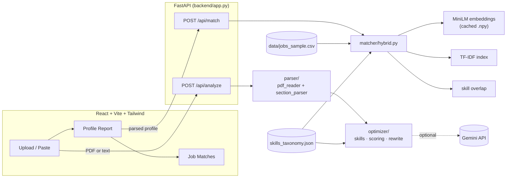
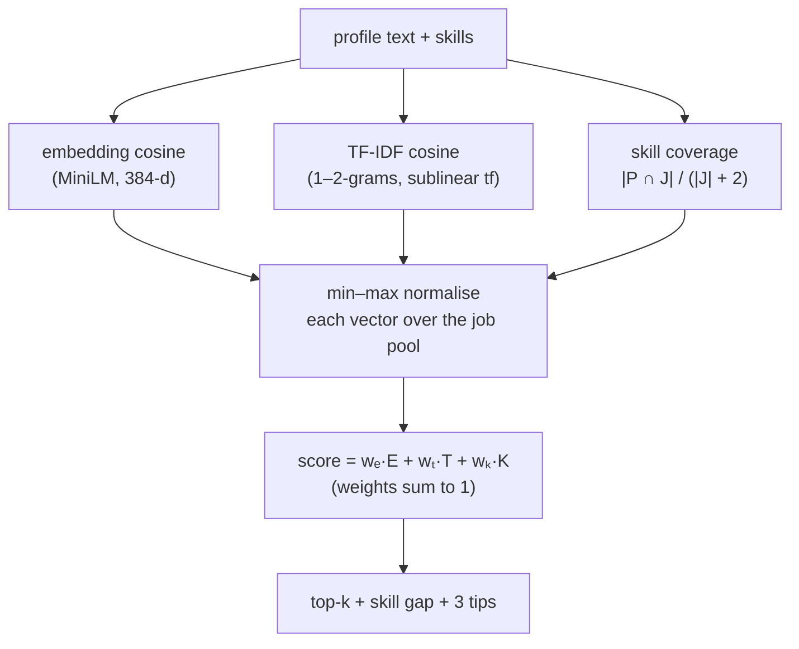

# Architecture

## 1. System overview

The server is **stateless**: uploads are parsed in memory and discarded. The browser keeps the parsed profile and sends it back with `/api/match`.

## 2. Parsing (`backend/parser/`)

LinkedIn's *Save to PDF* is **two-column**: a sidebar (Contact, Top Skills, Certifications) and a main column (name, headline, Summary, Experience, Education). Naive text extraction interleaves the columns line by line.

1. `pdf_reader.py` finds the x-coordinate of the main-column headings (*Summary / Experience / Education*) on page 1, crops each page into two columns and returns **all main-column pages, then all sidebar pages**.
2. `section_parser.py` splits on heading lines. Text above the first heading is the *preamble* (name, headline, location).
3. Experience is parsed by **anchoring on date-range lines** (`March 2022 - Present (2 years 8 months)`): the title sits one line above, the company one more line above (inherited when several roles share a company), the description below. A second path handles inline style (`Software Engineer at Acme (Jan 2021 – Present)`) for pasted text.

Known limitation: LinkedIn's PDF only exports the **top 3 skills**, so the UI offers a box for the full list.

## 3. Optimizer (`backend/optimizer/`)

### Skill extraction
spaCy `PhraseMatcher` over the taxonomy (~590 skills + ~190 aliases). Case-insensitive on the lower-cased token, except names that collide with English words (`R`, `Go`, `Spark`) and short aliases (`ML`, `AI`), which must match exactly. Overlaps are resolved longest-first (`C++` is not also `C`).
**Missing skills** = skills found in *experience / about* that are not in the Skills section (after alias normalisation, so listing `ML` counts as listing *Machine Learning*).

### Scoring rubric
Section score = Σ (metric score × metric weight); overall = Σ (section score × section weight). Weights live in `scoring.py` (`SECTION_WEIGHTS`, `METRIC_WEIGHTS`) and a unit test asserts every row sums to 1.

| Section (weight) | Metrics (weight) |
|---|---|
| **Headline** (15%) | completeness .30 · length .30 (ideal 60–150 chars) · keywords .30 · clarity .10 |
| **About** (25%) | completeness .15 · length .20 (120–350 words) · action verbs .15 · quantified .15 · keywords .20 (8+ skills) · readability .15 (Flesch 30–70) |
| **Experience** (30%) | completeness .25 · length .15 (40–120 words/role) · action verbs .20 · quantified .20 · keywords .10 · readability .10 (8–35-word statements) |
| **Education** (10%) | completeness .60 · detail (field of study) .40 |
| **Skills** (15%) | count .35 (15–50) · recognised .20 · coverage of experience .30 · diversity .15 |
| **Certifications** (5%) | count .70 · completeness .30 |

`band(x, lo_bad, lo_ok, hi_ok, hi_bad)` is a trapezoid: 0 outside the outer bounds, 1 inside the inner bounds, linear in between — so "ideal length" is a range, not a cliff. A missing section scores 0 with a single instruction instead of per-metric noise. These thresholds are **heuristics from common LinkedIn guidance, not learned parameters**.

### Rewrites
* **Gemini** (if `GEMINI_API_KEY` is set): the prompt carries only headline, about, the three latest roles and skills — never name, location or contact details — and instructs the model not to invent facts. The key is sent in a header (not the URL).
* **Rule-based fallback** (also used on any API error): templates filled from the user's own facts (role, top skills, years, quantified bullets). A unit test checks that every number in the output already appears in the profile.

## 4. Matching (`backend/matcher/`)

For one profile and N jobs:

* **Why three signals?** Embeddings capture meaning (*"built ML pipelines"* ≈ *"machine learning engineer"*) but are fuzzy; TF-IDF rewards exact rare keywords but misses synonyms; skill overlap is the most explainable and powers the gap view.
* **Smoothed coverage.** `|P∩J| / (|J|+2)` stops a posting that lists one skill from scoring 100% because you happen to have it.
* **Per-query min–max normalisation.** Cosines from the two models live on different scales (≈0.2–0.6 vs ≈0.02–0.3), so each is rescaled to 0–1 across the job pool before mixing. Consequence: the score is **relative** ("how good versus the other jobs for you"), not a probability. Raw cosine is also returned.
* **Pasted JD.** A single JD is normalised using the *pool's* min/max, so its score is comparable with the dataset matches.
* **Truncation.** MiniLM reads ≈256 word-pieces. Job text is `title · title · skills · description` and profile text is `headline · skills · about · experience · …`, so the most informative text comes first.
* **Tips** (exactly three) are templates filled with job-specific evidence: (1) the top missing skills + a category-appropriate first step, (2) headline alignment with the job title or leading with matched skills, (3) the job's most distinctive keywords absent from the profile.

## 5. Evaluation (`backend/eval/`)

See [`RESULTS.md`](RESULTS.md) for numbers and caveats. The runner reuses the app's scoring code (`raw_scores → normalised → combine`), so the evaluation measures the shipped system rather than a re-implementation.

* **Labelled set:** 30 synthetic profiles × a 100-job candidate pool (5 relevant, 3 adjacent, 30 hard negatives, 62 random). Relevance is a regex on the job title per role family — a documented proxy.
* **Metrics** (`metrics.py`, unit-tested against hand-computed values): Precision@5, Recall@10, MRR, NDCG@10 (graded gain 2ᵍ−1).
* **Rigor extras:** random baseline, 95% bootstrap CIs, paired bootstrap for differences, explicit-vs-obfuscated breakdown, and 2-fold cross-validated weight selection.

## 6. Design decisions & trade-offs

| Decision | Why | Trade-off |
|---|---|---|
| Rule-based parser, no ML | Deterministic, explainable, no training data needed | Brittle on unusual layouts; paste mode is the escape hatch |
| Taxonomy matching instead of NER | Skills aren't standard NER entities; O(n) matching; transparent | Blind to skills not in the taxonomy |
| Stateless API | Privacy by construction; trivial to deploy | Client re-sends the profile |
| Gemini optional with fallback | Works offline; no vendor lock-in | Rule-based text is plainer |
| Dataset sample in the repo (6 MB) | Clone-and-run, reproducible evaluation | A sample, not the full 124k postings |
